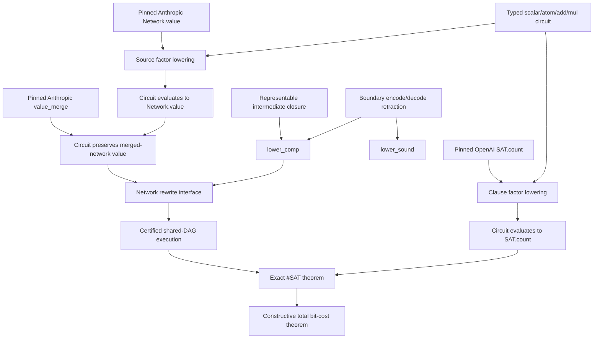

# Adaptive Certified Contraction: typed arithmetic circuit proof DAG

**Status:** semantic foundation under development. No fast #SAT algorithm or
OpenAI packet-algorithm lowering is established by this module.

## Mathematical object

The circuit IR at
[`instrumentation/lean-env/ACC/Circuit.lean`](../instrumentation/lean-env/ACC/Circuit.lean)
has **explicit** integer scalar, source factor, addition and multiplication
gates. `sumList`, `prodList`, `sumFinset` and `prodFinset` lower finite
algebraic combinations into that syntax. An atom valuation supplies only one
source factor, never the whole count or network contraction.

The source adapters at
[`eth/proofs/IndependentCircuitSource.lean`](../eth/proofs/IndependentCircuitSource.lean)
build these circuits from pinned definitions:

- **Anthropic:** the actual `Groundwork.Network` node states, node weights,
  allowed edge labels, and two endpoint factors. The evaluation theorem
  identifies this circuit with the original `N.value`. By applying the
  original pinned `Groundwork.Network.value_merge`, a separate theorem proves
  that compiling a merged network preserves the circuit evaluation.
- **OpenAI:** the actual pinned `SAT.CNF` semantics, with one atom per
  clause and full Boolean assignment, and explicit arithmetic products over
  clauses and sums over assignments. The evaluation theorem identifies this
  exhaustive circuit with `SAT.count`. This is a semantic starting point,
  **not** a compilation of the OpenAI packet program.

The core IR is a **tree**. It can be exponentially large and does not yet
represent shared nodes. A DAG backend, structural hash-consing, circuit
extraction, and cost-verified optimizers are further work. No `#SAT` oracle
is hidden in a gate.

## Dependency DAG

### What each edge proves

1. **Source-factor lowering:** exposes every original factor as a circuit atom.
   It does *not* assert compression or runtime efficiency.
2. **Semantic evaluation:** multiplication and finite summation match the
   source's integer contraction.
3. **Anthropic merge:** the original source theorem ensures value preservation
   despite different node and atom types after grouping. This is equality
   under the *designated* source valuations, not a polymorphic rewrite valid
   under arbitrary valuations.
4. **Boundary composition:** `lower_comp` holds only when the intermediate
   state is representable. A two-coordinate counterexample demonstrates why
   the closure hypothesis cannot be omitted.
5. **DAG simulation:** still missing. Requires typed node identity, sharing,
   an acyclic evaluation order, and a per-node proof-carrying rewrite relation.
6. **Subexponential cost:** still missing. Requires constructive compression,
   resource-accounted planning, coefficient bit bounds, and a complete
   recurrence. Semantic equivalence is insufficient.

## Context-uniform quotient through Anthropic merge

[Boundary quotient source proof](../eth/proofs/IndependentBoundaryQuotient.lean)
defines an explicit state map (q : \sigma\to K) and a representative
(r : K\to\sigma). Its source-side hypothesis is

\[
\forall a,b,s,t,\quad f_{ab}(s,t)=f_{ab}(r(q(s)),t).
\]

For an Anthropic node (a), the ACTUAL `Network.toInst` table entry is

\[
T_a(\theta)=
 \sum_{s\in S_a} W_a(s)\prod_{b\ne a}
 [\theta_b\in D_{ab}]\, f_{ab}(s,\mathrm{dec}_{ab}(\theta_b)).
\]

The quotient weights aggregate **all** original states with the same
label, rather than replacing their weights with a representative:

\[
\bar W_a(k)=\sum_{s\in S_a:q(s)=k}W_a(s).
\]

The local exact identity, for **every** outside assignment (\theta), is

\[
\boxed{
T_a(\theta)=
\sum_{k\in q(S_a)}\bar W_a(k)
\prod_{b\ne a}
 [\theta_b\in D_{ab}]\,
 f_{ab}(r(k),\mathrm{dec}_{ab}(\theta_b)).
}
\]

This is a true non-injective quotient: different states may share one
boundary class, while their weights are added. It is not merely equality
of the completed network's scalar contraction.

### What survives original merge?

Anthropic's original `Network.merge color defaultState defaultLabel`
forms each merged half-edge factor as a product of source factors.
The pointwise-lifted quotient

\[
q^G(z)(a)=q(z(a)),\quad r^G(k)(a)=r(k(a))
\]

preserves every merged outgoing factor, because **every factor of the
product** is invariant under the original quotient. Therefore the
merged network's `toInst` table also has a context-uniform quotient.

This is preservation of the *factor-invariance certificate through merge*.
It is **not yet** a statement that quotienting the source network before
merging produces an isomorphic smaller merged network. A native quotient
network constructor and its functoriality remain open.

### Constructive/computational limitations

The proof uses a finite image and fiber sums. It establishes no bound
on the time to discover (q), the class count \(|q(S_a)|\), the work
to enumerate the fibers, the size of a merged state, or the final circuit.
The best-case strict compression (two distinct Boolean states to one class)
is elementary; it does not imply a uniform reduction on arbitrary SAT
networks. The OpenAI packet/mode transform is not an instance of this
proof until its corresponding factor invariance is independently shown.

## Specific next proofs

| Milestone | Lean-level requirement | Acceptance condition |
| --- | --- | --- |
| C1 | Arithmetic tree evaluator and finite-fold lemmas | Lean kernel check, no admissions |
| C2 | Pinned Anthropic `Network.value` and `value_merge` adapter | Kernel check, exact original import |
| C3 | Pinned OpenAI `SAT.count` adapter | Kernel check, unused variables included |
| C4 | Typed shared DAG | Exact evaluation, acyclicity, sharing without recomputation |
| C5a | Anthropic factor-invariant quotient after merge | Pointwise outgoing table identity and lifted source factors; exact-head Lean check pending | 
| C5b | Quotient-before-merge full circuit square | Construct quotient network and show the two rewrite orders agree; open |
| C6 | OpenAI source-defined packet transform | Original packet constructor, factor/port identities, precision and routing |
| C7 | Combined recursion, complexity | Full constructive bit and peak-space recurrence |

`C1-C3` form the first verified milestone. `C5a` is a second, separate proof
obligation in this branch; it does not imply `C5b`, a shared executable DAG,
or a new complexity bound.

## Toolchain and verification

The existing `lean-independent-formulations.yml` workflow pins Lean 4.34.1
and Mathlib at `d13f23b723b8a846827a245b89c10fc7d3f11612`, fetches the
unaltered OpenAI and Anthropic source snapshots, and checks the new modules.
The workflow rejects `sorry`/`admit` in the new source adapter and core IR.

Keep the distinctions between source identity, mathematical equivalence,
proof of executable correspondence, and total complexity explicit.
