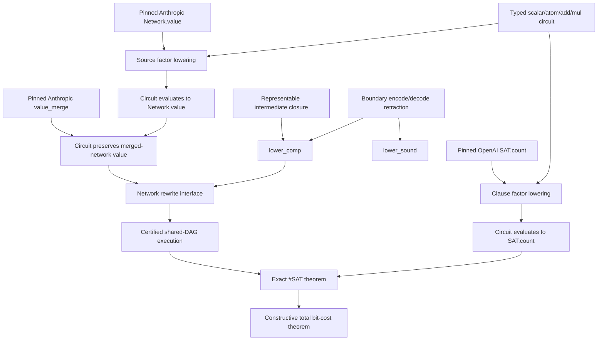

# Adaptive Certified Contraction: typed arithmetic circuit proof DAG

**Status:** semantic foundation under development. No fast #SAT algorithm or
OpenAI packet-algorithm lowering is established by this module.

## Mathematical object

The circuit IR at
[`instrumentation/lean-env/ACC/Circuit.lean`](../instrumentation/lean-env/ACC/Circuit.lean)
has **explicit** integer scalar, source factor, addition and multiplication
gates. `sumList`, `prodList`, `sumFinset` and `prodFinset` lower finite
algebraic combinations into that syntax. An atom valuation supplies only one
source factor, never the whole count or network contraction.

The source adapters at
[`eth/proofs/IndependentCircuitSource.lean`](../eth/proofs/IndependentCircuitSource.lean)
build these circuits from pinned definitions:

- **Anthropic:** the actual `Groundwork.Network` node states, node weights,
  allowed edge labels, and two endpoint factors. The evaluation theorem
  identifies this circuit with the original `N.value`. By applying the
  original pinned `Groundwork.Network.value_merge`, a separate theorem proves
  that compiling a merged network preserves the circuit evaluation.
- **OpenAI:** the actual pinned `SAT.CNF` semantics, with one atom per
  clause and full Boolean assignment, and explicit arithmetic products over
  clauses and sums over assignments. The evaluation theorem identifies this
  exhaustive circuit with `SAT.count`. This is a semantic starting point,
  **not** a compilation of the OpenAI packet program.

The core IR is a **tree**. It can be exponentially large and does not yet
represent shared nodes. A DAG backend, structural hash-consing, circuit
extraction, and cost-verified optimizers are further work. No `#SAT` oracle
is hidden in a gate.

## Dependency DAG

### What each edge proves

1. **Source-factor lowering:** exposes every original factor as a circuit atom.
   It does *not* assert compression or runtime efficiency.
2. **Semantic evaluation:** multiplication and finite summation match the
   source's integer contraction.
3. **Anthropic merge:** the original source theorem ensures value preservation
   despite different node and atom types after grouping. This is equality
   under the *designated* source valuations, not a polymorphic rewrite valid
   under arbitrary valuations.
4. **Boundary composition:** `lower_comp` holds only when the intermediate
   state is representable. A two-coordinate counterexample demonstrates why
   the closure hypothesis cannot be omitted.
5. **DAG simulation:** still missing. Requires typed node identity, sharing,
   an acyclic evaluation order, and a per-node proof-carrying rewrite relation.
6. **Subexponential cost:** still missing. Requires constructive compression,
   resource-accounted planning, coefficient bit bounds, and a complete
   recurrence. Semantic equivalence is insufficient.

## Specific next proofs

| Milestone | Lean-level requirement | Acceptance condition |
| --- | --- | --- |
| C1 | Arithmetic tree evaluator and finite-fold lemmas | Lean kernel check, no admissions |
| C2 | Pinned Anthropic `Network.value` and `value_merge` adapter | Kernel check, exact original import |
| C3 | Pinned OpenAI `SAT.count` adapter | Kernel check, unused variables included |
| C4 | Typed shared DAG | Exact evaluation, acyclicity, sharing without recomputation |
| C5 | Compressed Anthropic merge | Construct `encode`/`decode`, prove closure and local circuit refinement |
| C6 | OpenAI source-defined packet transform | Original packet constructor, factor/port identities, precision and routing |
| C7 | Combined recursion, complexity | Full constructive bit and peak-space recurrence |

`C1-C3` are the scope of the first implementation. `C4-C7` are **not
claimed** by `C1-C3`.

## Toolchain and verification

The existing `lean-independent-formulations.yml` workflow pins Lean 4.34.1
and Mathlib at `d13f23b723b8a846827a245b89c10fc7d3f11612`, fetches the
unaltered OpenAI and Anthropic source snapshots, and checks the new modules.
The workflow rejects `sorry`/`admit` in the new source adapter and core IR.

Keep the distinctions between source identity, mathematical equivalence,
proof of executable correspondence, and total complexity explicit.
