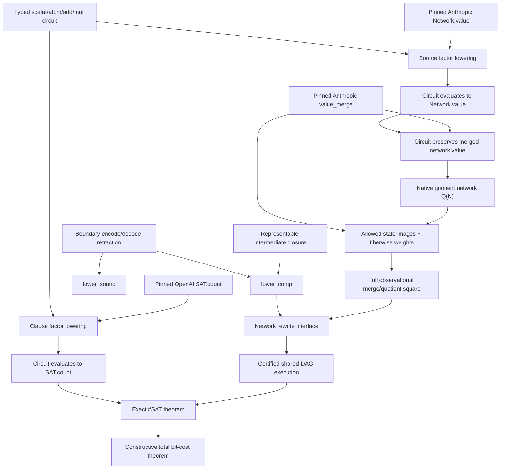
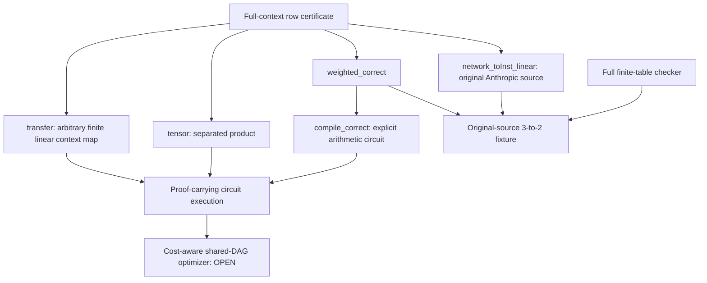

# Adaptive Certified Contraction: typed arithmetic circuit proof DAG

**Status:** semantic foundation under development. No fast #SAT algorithm or
OpenAI packet-algorithm lowering is established by this module.

## Mathematical object

The circuit IR at
[`instrumentation/lean-env/ACC/Circuit.lean`](../instrumentation/lean-env/ACC/Circuit.lean)
has **explicit** integer scalar, source factor, addition and multiplication
gates. `sumList`, `prodList`, `sumFinset` and `prodFinset` lower finite
algebraic combinations into that syntax. An atom valuation supplies only one
source factor, never the whole count or network contraction.

The source adapters at
[`eth/proofs/IndependentCircuitSource.lean`](../eth/proofs/IndependentCircuitSource.lean)
build these circuits from pinned definitions:

- **Anthropic:** the actual `Groundwork.Network` node states, node weights,
  allowed edge labels, and two endpoint factors. The evaluation theorem
  identifies this circuit with the original `N.value`. By applying the
  original pinned `Groundwork.Network.value_merge`, a separate theorem proves
  that compiling a merged network preserves the circuit evaluation.
- **OpenAI:** the actual pinned `SAT.CNF` semantics, with one atom per
  clause and full Boolean assignment, and explicit arithmetic products over
  clauses and sums over assignments. The evaluation theorem identifies this
  exhaustive circuit with `SAT.count`. This is a semantic starting point,
  **not** a compilation of the OpenAI packet program.

The core IR is a **tree**. It can be exponentially large and does not yet
represent shared nodes. A DAG backend, structural hash-consing, circuit
extraction, and cost-verified optimizers are further work. No `#SAT` oracle
is hidden in a gate.

## Dependency DAG

### What each edge proves

1. **Source-factor lowering:** exposes every original factor as a circuit atom.
   It does *not* assert compression or runtime efficiency.
2. **Semantic evaluation:** multiplication and finite summation match the
   source's integer contraction.
3. **Anthropic merge:** the original source theorem ensures value preservation
   despite different node and atom types after grouping. This is equality
   under the *designated* source valuations, not a polymorphic rewrite valid
   under arbitrary valuations.
4. **Boundary composition:** `lower_comp` holds only when the intermediate
   state is representable. A two-coordinate counterexample demonstrates why
   the closure hypothesis cannot be omitted.
5. **DAG simulation:** still missing. Requires typed node identity, sharing,
   an acyclic evaluation order, and a per-node proof-carrying rewrite relation.
6. **Subexponential cost:** still missing. Requires constructive compression,
   resource-accounted planning, coefficient bit bounds, and a complete
   recurrence. Semantic equivalence is insufficient.

## Context-uniform quotient through Anthropic merge

[Boundary quotient source proof](../eth/proofs/IndependentBoundaryQuotient.lean)
defines an explicit state map \(q : \sigma\to K\) and a representative
\(r : K\to\sigma\). Its source-side hypothesis is

\[
\forall a,b,s,t,\quad f_{ab}(s,t)=f_{ab}(r(q(s)),t).
\]

For an Anthropic node \(a\), the ACTUAL `Network.toInst` table entry is

\[
T_a(\theta)=
 \sum_{s\in S_a} W_a(s)\prod_{b\ne a}
 [\theta_b\in D_{ab}]\, f_{ab}(s,\mathrm{dec}_{ab}(\theta_b)).
\]

The quotient weights aggregate **all** original states with the same
label, rather than replacing their weights with a representative:

\[
\bar W_a(k)=\sum_{s\in S_a:q(s)=k}W_a(s).
\]

The local exact identity, for **every** outside assignment \(\theta\), is

\[
\boxed{
T_a(\theta)=
\sum_{k\in q(S_a)}\bar W_a(k)
\prod_{b\ne a}
 [\theta_b\in D_{ab}]\,
 f_{ab}(r(k),\mathrm{dec}_{ab}(\theta_b)).
}
\]

This is a true non-injective quotient: different states may share one
boundary class, while their weights are added. It is not merely equality
of the completed network's scalar contraction.

### Full quotient/merge commuting square (verified)

The **native** `quotientNetwork N q r` uses state sets \(q(S_a)\),
fiber-summed weights \(\bar W_a\), original labels and capacities, and
the outgoing factor \(f_{ab}(r(k),t)\). The source-facing theorem
`quotientNetwork_toInst` proves equality of every outgoing
`Network.toInst` table entry between \(N\) and its quotient.

Anthropic's original `Network.merge color defaultState defaultLabel`
builds merged states as function-valued tuples. The lifted quotient is

\[
q^G(z)(a)=q(z(a)),\qquad r^G(k)(a)=r(k(a)).
\]

**The full observed network square is now proved** under factor invariance:

\[
\boxed{
\operatorname{toInst}\bigl(\operatorname{merge}(Q(N))\bigr)
=
\operatorname{toInst}\bigl(Q(\operatorname{merge}(N))\bigr).
}
\]

This equality is uniform over all external instance label sets and
decoders. The proof goes beyond the earlier scalar equality:

1. `quotient_merge_states_commute`: the *admissible* merged state
   sets are equal; this is an exact image-of-tuples theorem.
2. `tuple_fiber_product`: a weighted sum over the fiber of a
   merged state is the product of the individual state-fiber sums.
3. `quotient_pair_interaction`: the actual source `Network.Ψ`
   is invariant under representative replacement at both ends.
4. `quotient_merge_weight_on_states`: merged node weights agree
   on **admissible** states, using the previous two lemmas.
5. Factors, `Θ` labels and capacities agree componentwise,
   giving `quotient_merge_network_agreement`.
6. `NetworkAgreement.toInst` derives the final context-uniform
   `quotient_merge_toInst_commutes` for the actual pinned source.

It would be incorrect to require the arbitrary `W` functions to be
identical on states forbidden by `S`; those entries are not read
during contraction. The proved equivalence is exact observational
network equivalence, not literal structure equality at invalid inputs.

**Evidence:** [pinned Lean 4.34.1 run #44109954836](https://github.com/laurajoyhutchins/eth-disproof-rust/actions/runs/44109954836)
on commit `d9304a4fd760b1709b41f868a4adb8ca24892a49`.
All three workflows passed. The new `#print axioms` declarations show
only `propext`, `Classical.choice` and `Quot.sound`, no `sorryAx`.

### An obstruction at OpenAI's zero deformation

The October 25 appendix specifies a Cauchy packet deformation satisfying
\(W(0)=I\). The induced binary port glue at \(T=0\) is the exact identity
kernel \(K(Y,X)=\mathbf1[Y=X]\).

The generic Lean theorem `identity_kernel_forces_injective_labels`
proves that any **state-identification** quotient whose representative
preserves every identity-kernel entry has injective labels. Therefore
there is no nontrivial state merging of that full identity interface.

This does **not** rule out correlated linear operators, spectral modes,
symbolic circuits, or exploiting restricted/weighted contexts. It
does prevent automatically transferring our Anthropic factor-class
compression to the OpenAI packet glue.

### Constructive/computational limitations

The proof uses finite images and fiber sums. It establishes no bound
on the time to discover \(q\), the class count \(|q(S_a)|\), the work
to enumerate the fibers, the size of a merged state, or the final circuit.
The best-case strict compression (two distinct Boolean states to one class)
is elementary; it does not imply a uniform reduction on arbitrary SAT
networks. The OpenAI packet/mode transform is not an instance of this
proof until its corresponding factor invariance is independently shown.

## Beyond equal-signature quotients: exact linear boundary interfaces

[The integer linear-interface proof](../instrumentation/lean-env/ACC/LinearInterface.lean)
and its [original Anthropic network adapter](../eth/proofs/IndependentLinearBoundary.lean)
extend the quotient method without requiring two states to have the
same outgoing behavior.

For source states \(s\), contexts \(\theta\), integer coefficients
\(A_{si}\), and basis functions \(G_i\), the certificate is

\[
\forall s\in S,\ \forall\theta,\qquad
B_s(\theta)=\sum_{i\in I}A_{si}G_i(\theta).
\]

Weight aggregation then preserves **every** outside context:

\[
\boxed{
\sum_{s\in S}w_s B_s(\theta)
=
\sum_{i\in I}\left(\sum_{s\in S}w_s A_{si}\right)G_i(\theta).
}
\]

This admits genuine linear dependence, not only duplicate rows.
The small fixture uses three distinct rows
\((1,0),(0,1),(1,1)\) represented by two modes.
Its source-specific `exampleNetwork` has weights \(1,2,3\);
the original pinned `Network.toInst` evaluates to \(4,5\),
exactly as the compressed mode calculation.

### Verified proof DAG

- **`weighted_correct`:** push state weights into the basis
  coefficients, in \(\mathbb Z\), for all boundary contexts.
- **`transfer`:** applying a finite linear continuation kernel
  preserves the *same* mode set, but evaluating the transformed
  basis may still cost a finite sum over all source contexts.
- **`tensor`:** separated products admit a product basis.
  Their mode counts multiply, so repeated tensorization can
  rebuild exponential width.
- **`checkFinite_sound` / `fromChecked`:** if a complete finite
  context table passes a decidable reconstruction check, its
  resulting interface carries a proof for *all* contexts of
  that finite type. Checking only selected contexts would be
  insufficient.
- **`compile_correct`:** the interface compiles to the existing
  arithmetic-circuit IR using explicit `stateWeight`,
  `coordinate` and `modeValue` atoms. The compiler does not
  substitute the final count as a scalar.
- **`network_toInst_linear`:** uses the *actual pinned*
  `Groundwork.Network.toInst` definition to prove exact
  instance-table equality on all source boundary assignments,
  conditional on the stated factorization certificate.
- **`example_source_table_checked` / `example_source_toInst`:**
  an executable finite check supplies that certificate for
  an actual 3-state, 2-mode source network.

**Proof evidence:** [pinned Lean 4.34.1 run #44115242060](https://github.com/laurajoyhutchins/eth-disproof-rust/actions/runs/44115242060)
on commit `bde06b139f606cf7ed3de5b93358e9964e0a323d`.
New theorem axiom reports contain only `propext`, `Classical.choice`,
and `Quot.sound`, no `sorryAx`.

### Computational boundary

A supplied \(s\times r\) coefficient table and \(r\)-mode basis
may be smaller than a stored \(s\times c\) boundary table.
However:

- The explicit full-context verifier reads all \(c\) contexts,
  and \(c\) can itself be exponential in SAT boundary size.
- Forming aggregated coefficients costs at least the data it
  reads; for **one** context evaluation, the compiled mode
  circuit can be more expensive than direct summation.
- Only repeated use or structured symbolic basis construction
  can amortize conversion and coefficient aggregation.
- The `modeValue` atom is an explicit input factor, but its
  **evaluation cost and bit length are not yet certified**.
  An expensive basis oracle cannot be treated as free.
- The generic tensor-product theorem does **not** prove
  bounded mode width through Anthropic's actual merge.
- OpenAI's source-defined packet/mode operations still need
  their own admissibility, precision, and routing correspondence.

No global \(2^{o(n)}\) bound, optimal-circuit claim, or #SAT
speedup follows from these new exact identities.

## Compact full-rank operator portfolio (verified)

The [factored-operator module](../instrumentation/lean-env/ACC/FactoredOperator.lean)
complements low-rank boundary interfaces. A tensor identity on \(n\)
Boolean ports is a \(2^n\times 2^n\) matrix of rank exactly \(2^n\)
over \(\mathbb Q\), but needs only \(n\) explicit \(2\times 2\)
integer wire matrices, or \(4n\) scalar entries without sharing.

The **verified** theorem `identity_rank` proves full rank. The
`identity_forces_injective` theorem proves that a representative-based,
all-context state quotient cannot merge any of these rows.

If both a kernel and input are factored, we have

\[
\sum_{X\in\{0,1\}^n}
 \left(\prod_i K_i(Y_i,X_i)\right)
 \left(\prod_i v_i(X_i)\right)
=
\prod_i\left(\sum_{b\in\{0,1\}}
 K_i(Y_i,b)v_i(b)\right).
\]

`applyProduct_correct` proves this equality for every output assignment,
without enumerating all \(2^n\) assignments in the symbolic
right-hand expression. The theorem is about mathematical semantics;
an executable library implementation and bit-operation/peak-space receipts
are still needed.

### Source-specific zero-deformation boundary

The pinned OpenAI October 25 quantitative-contraction appendix specifies
\[
F(T)=\sum_{X,Y} A(Y)B(X)
 \prod_i \ell_{Y_i}((W(T)X)_i)
\]
and states \(W(0)=I\) under the packet's original edge identification.

The [independent zero-glue adapter](../eth/proofs/IndependentOpenAIZeroGlue.lean)
proves that **if** the supplied \(W_0\) satisfies
\(W_0 X\,i=\mathbf1[X_i=\mathrm{true}]\), then

\[
\prod_i\ell_{Y_i}((W_0X)_i)=\mathbf1[Y=X],
\qquad
F(0)=\sum_X A(X)B(X).
\]

This is a checked consequence of an explicit **hypothesis**, not a
source-derived proof that the entire original Lean packet construction
implements \(W(0)=I\). Nonzero deformations, ring precision, correlated
modes, reconstruction, and recursion remain unproved by this adapter.

### Certified semantics, estimated costs

The `EstimatedCandidate` selector and
`choose_direct_or_factored_correct` compare two implementations of
the **same** product-input contraction. Selection by a declared score
preserves semantics regardless of estimate accuracy. The selector does
**not** prove that the score equals actual bit cost or peak memory.

A correlated vector need not factor at all. For example the two-port
table \(v(00)=v(11)=1\), \(v(01)=v(10)=0\) has nonzero
\(2\times 2\) determinant and cannot be a single product \(v_1\otimes v_2\).
Therefore the factorized execution theorem cannot be applied to
unstructured input amplitudes without a separate decomposition.

**Exact-head proof evidence:** [pinned Lean 4.34.1 run #44128037240](https://github.com/laurajoyhutchins/eth-disproof-rust/actions/runs/44128037240)
at commit `70b1b14a1404e28fefd6be5a5f70a5715ced49c0`.
The new axiom reports contain only Lean's standard axioms,
without `sorryAx`.

## Specific next proofs

| Milestone | Lean-level requirement | Acceptance condition |
| --- | --- | --- |
| C1 | Arithmetic tree evaluator and finite-fold lemmas | Lean kernel check, no admissions |
| C2 | Pinned Anthropic `Network.value` and `value_merge` adapter | Kernel check, exact original import |
| C3 | Pinned OpenAI `SAT.count` adapter | Kernel check, unused variables included |
| C4 | Typed shared DAG | Exact evaluation, acyclicity, sharing without recomputation |
| C5a | Anthropic factor-invariant quotient after merge | Verified in pinned Lean | 
| C5b | Native quotient/merge observational network square | Verified in pinned Lean for all admissible states and external toInst tables |
| C5c | Linear boundary basis, transfer/tensor, circuit IR, pinned source adapter | Verified in pinned Lean with a full-table fixture |
| C5d | Efficient basis discovery and bounded mode growth through original merge | Open: construction and whole-program resource certificate |
| C5e | Full-rank factored identity kernel and product-state execution | Verified: matrix rank \(2^n\), \(4n\) explicit table entries, factorized action |
| C5f | Conditional OpenAI zero-deformation selector identity | Verified assuming supplied \(W_0=I\); original packet source proof still open |
| C5g | Safe choice of exact direct and factored candidates | Verified semantics for any declared estimated score; certified bit cost open |
| C6 | OpenAI source-defined packet transform | Original packet constructor, factor/port identities, precision and routing |
| C7 | Combined recursion, complexity | Full constructive bit and peak-space recurrence |

`C1-C3`, `C5a-C5c` and `C5e-C5g` are verified under their exposed assumptions.
Neither a shared executable DAG, a source-derived OpenAI packet adapter,
nor a new bit-complexity bound follows from these semantic theorems.

## Toolchain and verification

The existing `lean-independent-formulations.yml` workflow pins Lean 4.34.1
and Mathlib at `d13f23b723b8a846827a245b89c10fc7d3f11612`, fetches the
unaltered OpenAI and Anthropic source snapshots, and checks the new modules.
The workflow rejects unresolved admissions in the circuit IR, the linear-interface
modules, the factored-operator module and the original-source adapters.

Keep the distinctions between source identity, mathematical equivalence,
proof of executable correspondence, and total complexity explicit.
